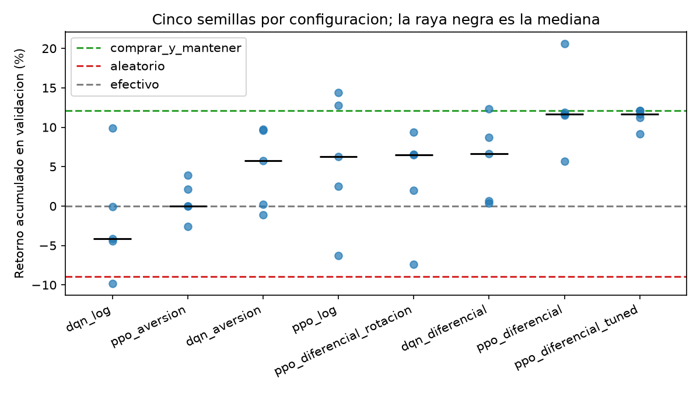
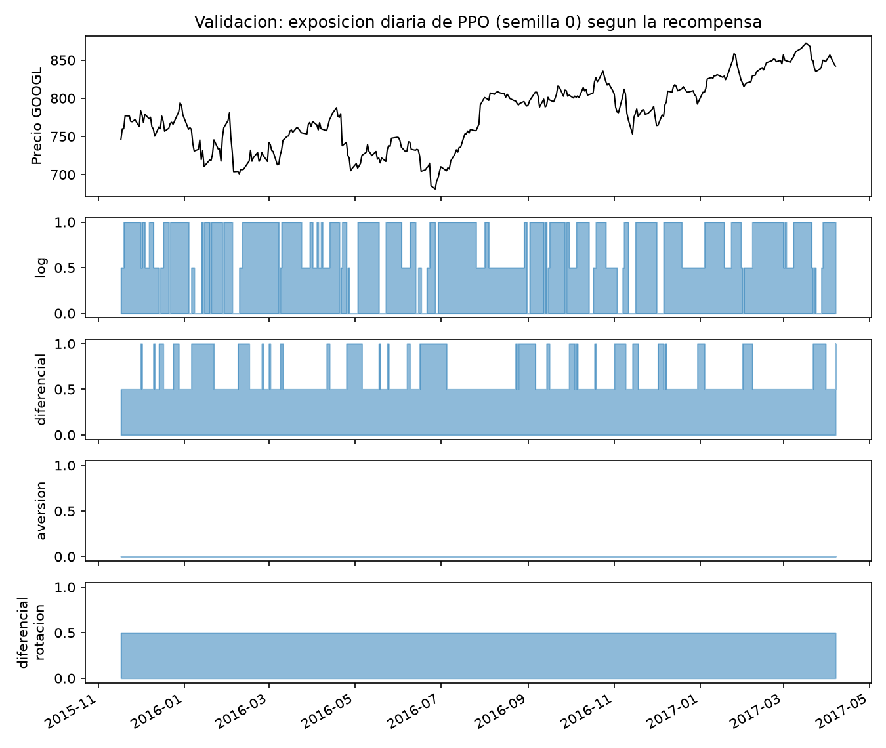

# Agente Inversor

[](https://github.com/glizano/agente_inversor/actions/workflows/ci.yml)
[](LICENSE)

Proyecto final de Simulación y Aprendizaje por Refuerzo (EFMIA-SAPR20265), Maestría en
Inteligencia Artificial, Universidad de La Sabana.

Autores: Leonar Socarrás Molina (leonarsomo@unisabana.edu.co), John Jairo Serrano Cifuentes (johnseci@unisabana.edu.co), Brezhnev Joya Miranda (brezhnevjomi@unisabana.edu.co), Gabriel Alonso Lizano Alvarado (gabriellial@unisabana.edu.co), Bryan Johann Aranzazu Medina (bryanarme@unisabana.edu.co). Docente: Emilio Muñoz Pérez.

## Resumen

Formulamos la inversión en una sola acción (GOOGL, cierre diario) como un proceso de
decisión: cada día el agente observa siete indicadores y decide tener invertido el 0 %, el
50 % o el 100 % del capital, pagando 0,1 % por el capital que mueve. Comparamos tres
funciones de recompensa y dos algoritmos (DQN y PPO, de Stable-Baselines3), con cinco
semillas cada combinación, y elegimos la configuración solo con el tramo de validación. Una
cuarta versión de la recompensa, entrenada después de observar a las tres primeras, corrigió
el exceso de operaciones pero introdujo otro problema, y no cambió la elección (sección 3).

En el tramo de prueba, usado una única vez, el agente elegido (PPO con recompensa
diferencial) obtuvo una mediana de +37,5 % entre sus cinco semillas, frente a +50,0 % de
comprar y mantener y +4,4 % del agente aleatorio. **No supera a comprar y mantener**: dos
de las cinco semillas lo hacen y tres no. La máxima caída mediana fue 13,8 %, contra 15,4 %
de comprar y mantener. La sección 6 discute por qué creemos que ese es el resultado
esperable y qué limita lo que se puede concluir.

Como segunda prueba fuera de muestra evaluamos los mismos cinco modelos, sin reentrenar,
de agosto de 2018 a diciembre de 2025 con datos de Yahoo Finance, un periodo que incluye
las caídas de 2020 y 2022. La mediana fue +243,9 % contra +398,2 % de comprar y mantener:
el agente sigue sin superarlo en retorno, aunque las semillas que más operan pierden
bastante menos en las caídas (sección 5, "Segunda prueba").

El proyecto parte de la base sugerida en clase,
[`rl_games_sb`](https://github.com/emiliomunozai/rl_games_sb): misma organización (CLI,
configuraciones en YAML, registro de algoritmos), seguimiento con MLflow y búsqueda de
hiperparámetros con Optuna. Lo propio del proyecto es el entorno, las recompensas, el
protocolo de evaluación y los baselines.

## Cómo reproducir

```bash
uv sync
uv run pytest -q                      # 13 pruebas del entorno, los datos y las métricas

# Análisis exploratorio (deja las figuras eda_*.png en resultados/)
uv run --with jupyter jupyter nbconvert --to notebook --execute --inplace notebooks/eda.ipynb

uv run agente-inversor inspeccionar   # datos, tramos, estado, acciones
uv run agente-inversor baselines --tramo validacion

scripts/comparar.sh 2                 # 30 corridas (2 en paralelo), cerca de 30 min en CPU
uv run agente-inversor tune    --config configs/ppo.yaml --recompensa diferencial
uv run agente-inversor entrenar --config configs/ppo_tuned.yaml --sufijo _tuned
uv run agente-inversor entrenar --config configs/ppo.yaml --recompensa diferencial_rotacion
uv run agente-inversor resumen        # tabla de validación

uv run agente-inversor prueba  --config configs/ppo.yaml --recompensa diferencial
uv run agente-inversor prueba  --config configs/ppo.yaml --recompensa diferencial \
                               --tramo prueba_extendida   # segunda prueba, 2018 a 2025
uv run python scripts/graficar.py
uv run python scripts/analisis_recompensas.py   # costos y posiciones por recompensa, en validación
uv run python scripts/analisis_rigor.py         # rebalanceo e intervalos de confianza (sección 6)

# Solo si se quiere volver a bajar la serie de Yahoo Finance (el CSV ya está en datos/)
uv run --no-project --with yfinance python scripts/descargar_datos.py

uv run mlflow ui                      # http://127.0.0.1:5000, experimento agente_inversor
```

En Windows, los comandos `uv` funcionan igual en CMD o PowerShell; `scripts/comparar.sh` es
un script de bash y se ejecuta desde Git Bash (o WSL).

Las semillas están fijas en los YAML (0 a 4) y los modelos entrenados están en `saves/`,
así que `prueba` reproduce la tabla final sin reentrenar. Al reentrenar en otra máquina los
números pueden variar levemente por diferencias de versión de PyTorch.

## 1. Formulación del problema

**Datos.** Cierre diario de GOOGL del 22 de mayo de 2009 al 29 de agosto de 2018 (2.335
días hábiles), el conjunto que trae `gym-anytrading`, la librería de entornos de inversión
incluida en la base del curso. Para la segunda prueba (sección 5) usamos el cierre ajustado de
GOOGL de Yahoo Finance hasta el 31 de diciembre de 2025, guardado en
`datos/GOOGL_yahoo_2018-07_2025-12.csv`. En los 42 días que comparten, las dos fuentes
difieren en un factor constante de 20,19 (la división de acciones de 2022, que Yahoo ya
ajusta), así que los retornos son idénticos y la serie continúa sin salto.

**Procedencia y licencia.** La serie principal es `STOCKS_GOOGL.csv`, distribuida dentro de
`gym-anytrading` 2.0.0 (licencia MIT): 2.335 velas diarias con fecha, apertura, máximo,
mínimo, cierre, cierre ajustado y volumen. El paquete no declara de dónde salen los datos;
el formato de columnas coincide con el de una descarga de Yahoo Finance. El agente usa solo
el cierre. El CSV de la segunda prueba se bajó con `yfinance` (licencia Apache 2.0 de la
librería); los datos en sí pertenecen a Yahoo, cuyos términos permiten el uso personal y no
comercial, y se versionan aquí solo para que la evaluación sea reproducible en un trabajo
académico. Ningún archivo contiene datos personales.

**Análisis exploratorio** (`notebooks/eda.ipynb`). Lo que se usa para diseñar se mide solo en
entrenamiento. Los retornos diarios tienen colas pesadas (curtosis en exceso de 13,4, diez días
más allá de 4 desviaciones cuando una normal esperaría 0,1), casi no tienen autocorrelación,
pero su valor absoluto sí: la volatilidad se agrupa. La caída más profunda de la serie
(−30,4 %, 2010) queda en entrenamiento; validación y prueba no pasan de −15,4 %. El volumen cae
de unos 6 a 2 millones de acciones diarias y no anticipa el retorno siguiente (correlación
0,02), así que no entra en el estado. Ningún indicador del estado tiene correlación con el
retorno del día siguiente por encima del umbral de ruido (±0,05): la señal disponible en el
precio es débil, y eso anticipa que comprar y mantener será difícil de superar.


**Estado**, siete números, todos calculados con los últimos 20 días:

| # | Indicador | Por qué |
|---|---|---|
| 1 | Último retorno, en unidades de volatilidad | Lo más reciente que pasó |
| 2 | Momento a 5 días | Tendencia de corto plazo |
| 3 | Momento a 20 días | Tendencia de la ventana |
| 4 | Media de 5 días contra media de 20 | Cruce de medias, la señal técnica más común |
| 5 | Volatilidad anualizada | Nivel de riesgo actual |
| 6 | Distancia al máximo de la ventana | Si el precio viene de una caída |
| 7 | Exposición actual (0, 0,5 o 1) | Ver abajo |

Los indicadores 1 a 4 y 6 se dividen por la volatilidad de la propia ventana. Así quedan en
una escala parecida sin usar ninguna estadística global de la serie, que sería una forma de
mirar el futuro. La exposición actual hace que el problema sea markoviano: el costo de la
próxima acción depende de dónde está el capital hoy.

**Acciones**, `Discrete(3)`: tener invertido el 0 %, el 50 % o el 100 % del capital. La
acción es la exposición objetivo, no una orden de compra o venta, de modo que repetir la
acción no opera ni cuesta.

| Acción | Exposición | Significado económico |
|---|---|---|
| 0 | 0 % | Todo el capital en efectivo, sin rendimiento: no se gana ni se pierde con el activo |
| 1 | 50 % | Posición prudente: la mitad del capital sigue al activo, la otra mitad queda en efectivo |
| 2 | 100 % | Totalmente expuesto: el capital sube y baja igual que el activo |

*Por qué tres niveles.* Es la granularidad mínima que expresa las tres actitudes que importan
(fuera, prudente, totalmente expuesto), funciona directamente con DQN y mantiene la política
fácil de interpretar en una gráfica de posiciones. Con más niveles (por ejemplo 0, 25, 50, 75
y 100 %) habría más transiciones posibles, y cada ajuste pequeño pagaría costo sin que el
análisis exploratorio muestre una señal tan fina que lo justifique.

*Qué no puede hacer el agente.* No puede apostar a la baja (posiciones cortas), apalancarse
por encima del 100 %, tomar exposiciones intermedias como 25 % o 75 %, usar órdenes
condicionales (*stop-loss*, *take-profit*), operar dentro del día ni repartir el capital entre
varios activos. En particular, en una caída lo mejor que puede hacer es quedarse en efectivo,
no ganar con ella.

**Dinámica.** El día *t* el agente ve hasta el cierre de *t*, decide, y cobra el retorno
de *t* a *t*+1. El final de los datos se marca como truncamiento y no como estado terminal,
porque invertir no "termina" ahí.

## 2. Entorno

`src/agente_inversor/envs.py`, compatible con Gymnasium.

- **Costo.** `|exposición nueva − actual| × 0,001`. Pasar de 0 % a 100 % cuesta el doble
  que pasar de 0 % a 50 %.
- **Sin información del futuro.** Una prueba cambia todos los precios posteriores a *t* y
  verifica que el estado en *t* no cambia (`test_el_estado_no_usa_precios_futuros`).
- **Contabilidad.** Otra prueba verifica que comprar y mantener reproduce exactamente el
  retorno del activo menos el costo de entrada.
- **Entrenamiento con ventanas aleatorias.** Cada episodio de entrenamiento es un año
  bursátil (252 días) que empieza en un día al azar del tramo de entrenamiento. En el primer
  borrador del proyecto el agente recorría siempre la misma serie de principio a fin y la
  memorizaba (+292 % en entrenamiento, −22 % en validación, con datos sintéticos). Las
  ventanas aleatorias son la medida que tomamos contra eso.

**Partición cronológica**, 70 / 15 / 15:

| Tramo | Fechas | Días | Comprar y mantener |
|---|---|---|---|
| Entrenamiento | 2009-06-23 a 2015-11-16 | 1.613 | +267,7 % |
| Validación | 2015-11-17 a 2017-04-07 | 350 | +12,1 % |
| Prueba | 2017-04-10 a 2018-08-29 | 351 | +50,0 % |
| Segunda prueba (Yahoo Finance) | 2018-08-30 a 2025-12-31 | 1.844 | +398,2 % |

Ningún retorno se cobra en dos tramos (`test_los_tramos_no_comparten_retornos` y
`test_prueba_extendida_continua_la_serie_sin_compartir_retornos`).

## 3. Diseño de la recompensa

Probamos cuatro recompensas. En todas, *r* es el retorno logarítmico diario de la cartera ya
neto del costo, en puntos porcentuales.

| Nombre | Definición | Qué esperábamos |
|---|---|---|
| `log` | *r* | Maximizar el crecimiento del capital. Es aditiva en el tiempo |
| `diferencial` | *r* menos el retorno del activo | Premiar solo lo que se gana **respecto a** comprar y mantener. Estar 100 % invertido vale 0 |
| `aversion` | *r* si es ganancia, 2*r* si es pérdida | Un agente más prudente, con menos caídas |
| `diferencial_rotacion` | `diferencial` menos 0,5 puntos por cada unidad de capital movida | Menos operaciones que `diferencial`, sin cambiar lo que se mide |

**Iteración del diseño.** Diseñamos las tres recompensas antes de entrenar, cada una pensada
para corregir un problema esperado de la anterior, y las entrenamos juntas con el mismo
protocolo (dos algoritmos, cinco semillas, 100.000 pasos) para comparar en igualdad de
condiciones el comportamiento que inducen. Los resultados confirmaron los problemas que
motivaron cada cambio. La versión 4 sí recorrió el ciclo completo de forma secuencial: se
diseñó después de observar el comportamiento de la versión 3, se entrenó y se comparó con
las anteriores en validación. En orden:

1. **Versión 1, `log`.** Primera recompensa: el crecimiento del capital, la elección
   natural. *Observación:* DQN logra el mejor retorno de entrenamiento de todo el
   experimento (+670 %) y el peor en validación (−4,1 %), con 100 operaciones en 350 días;
   PPO queda mejor, pero con mucha dispersión entre semillas (−6,3 % a +14,4 %).
   *Problema:* la recompensa premia igual estar invertido en un día alcista por suerte que
   por decisión, así que el agente persigue retornos de corto plazo, memoriza la serie de
   entrenamiento y opera en exceso (sus costos, 8,5 %, superan su pérdida neta).
2. **Versión 2, `aversion`.** *Modificación:* para pedir prudencia, las pérdidas pesan el
   doble. *Observación:* el agente deja de invertir (exposición 0,01 con PPO, 2 operaciones).
   *Problema:* *reward hacking*; cumple la recompensa sin invertir con prudencia, que era lo
   buscado.
3. **Versión 3, `diferencial`.** *Modificación:* en lugar de castigar pérdidas, se mide solo
   lo que se gana respecto al activo, de modo que estar 100 % invertido vale 0 y el agente
   solo se aparta del mercado cuando cree tener un motivo. *Observación:* mejor mediana en
   validación y menor dispersión con PPO. *Problema que queda:* la política de no hacer nada
   vale 0, un óptimo local cómodo al que varias semillas convergen (sección 6), y las que no
   convergen operan mucho: con PPO, las semillas 0, 1 y 2 hacen entre 56 y 66 operaciones en
   350 días y dos de ellas quedan por debajo de comprar y mantener.
4. **Versión 4, `diferencial_rotacion`, entrenada después de ver la versión 3.**
   *Diagnóstico:* el costo real de pasar de 0 % a 100 % es 0,1 puntos, frente a una
   desviación cercana a 1,5 puntos del retorno diario, así que en la recompensa casi no se
   distingue del ruido. *Modificación:* restar 0,5 puntos por cada unidad de capital movida,
   cinco veces el costo real. La penalización solo cambia la recompensa; el capital y las
   métricas siguen pagando únicamente el 0,1 %. El valor se fijó antes de entrenar y no se
   ajustó con validación. *Nuevo entrenamiento:* PPO, mismas cinco semillas y 100.000 pasos.
   *Observación:* la recompensa cumple su propósito, porque la rotación mediana baja de 28,5
   a 2,5 y los costos de 2,9 % a 0,3 %, pero la mediana en validación cae de +11,7 % a
   +6,5 %. *Problema nuevo:* las semillas 0 y 4 entran al 50 % el primer día y allí se
   quedan: la semilla 0 los 350 días (figura de exposición, panel inferior) y la 4 en 348 de
   350, con dos salidas de un día al 100 %. Cada episodio empieza en
   efectivo, y pasar a 100 % cuesta el doble de penalización que pasar a 50 %; una vez en
   50 %, cualquier ajuste vuelve a costar. El agente encontró otro óptimo local cómodo, con
   la mitad de la caída (7,1 %) y la mitad del retorno. Es una variante del mismo patrón de
   las versiones 2 y 3: la penalización castiga moverse, y el agente aprende a no moverse
   desde donde sea más barato quedarse.

Resultados en validación, mediana de cinco semillas por configuración (las métricas se
calculan siempre sobre el capital real, nunca sobre la recompensa):

| Configuración | Retorno entrenamiento | Retorno validación (mín. a máx.) | Máx. caída | Costos | Exposición media | Operaciones |
|---|---|---|---|---|---|---|
| PPO, `diferencial` | +285,6 % | **+11,7 %** (+5,7 a +20,6) | 14,2 % | 2,9 % | 0,80 | 56 |
| DQN, `diferencial` | +448,5 % | +6,7 % (+0,4 a +12,4) | 14,6 % | 5,6 % | 0,76 | 97 |
| PPO, `diferencial_rotacion` (versión 4) | +101,7 % | +6,5 % (−7,4 a +9,3) | 7,8 % | 0,3 % | 0,50 | 5 |
| PPO, `log` | +177,4 % | +6,3 % (−6,3 a +14,4) | 13,3 % | 3,2 % | 0,78 | 61 |
| DQN, `aversion` | +122,5 % | +5,7 % (−1,1 a +9,7) | 3,3 % | 1,9 % | 0,05 | 23 |
| PPO, `aversion` | +12,6 % | 0,0 % (−2,6 a +3,9) | 0,5 % | 0,2 % | 0,01 | 2 |
| DQN, `log` | +670,2 % | −4,1 % (−9,8 a +9,9) | 12,9 % | 8,5 % | 0,48 | 100 |
| *Comprar y mantener* | *+267,7 %* | *+12,1 %* | *14,2 %* | *0,1 %* | *1,00* | *1* |
| *Agente aleatorio* | | *−8,9 %* | *16,3 %* | *14,8 %* | *0,50* | *234* |

Los costos se expresan en porcentaje del capital inicial (sobre $100.000, 2,9 % son $2.900) y
salen de `scripts/analisis_recompensas.py`, que vuelve a recorrer los 35 modelos guardados en
validación sin reentrenarlos. En DQN con `log` los costos (8,5 %) son más que toda su pérdida
neta (−4,1 %): antes de costos habría ganado algo, y lo destruyó operando 100 veces.





**Comportamiento que induce cada recompensa:**

- **`aversion` enseña a no invertir.** Con pérdidas que pesan el doble, el valor esperado
  de estar en el mercado es negativo aunque el activo suba, y el agente aprende a quedarse
  en efectivo (exposición 0,01 con PPO). Cumple lo que se le pidió, casi no tiene caídas,
  pero renuncia al retorno. Es un caso de *reward hacking*: optimiza la recompensa sin hacer
  lo que queríamos, que era invertir con prudencia.
- **`log` con DQN memoriza.** Es la configuración con mejor retorno en entrenamiento
  (+670 %) y la peor en validación (−4,1 %), con 100 operaciones en 350 días. Aprendió
  cuándo entrar y salir en la serie de entrenamiento, y esas reglas no se sostienen fuera.
- **`diferencial` da el mejor resultado y la menor dispersión con PPO.** Como estar
  invertido vale 0, el agente solo se aparta de comprar y mantener cuando cree tener una
  razón. Dos de las cinco semillas convergen a estar casi siempre invertidas (5 o 6
  operaciones); las otras tres operan activamente.
- **PPO generaliza mejor que DQN** con la misma recompensa en `log` y `diferencial`. La
  brecha entre entrenamiento y validación es menor.
- **`diferencial_rotacion` deja de operar y se estaciona en 50 %.** Con la versión 4 los
  costos caen a la décima parte, aunque lo que el agente aprende es a quedarse quieto en una
  posición intermedia. Penalizar la acción, en vez del resultado, cambia de lugar el óptimo
  local sin eliminarlo.

Ninguna configuración supera a comprar y mantener en la mediana de validación.

## 4. Algoritmo y protocolo de evaluación

### Algoritmo e hiperparámetros

Usamos **DQN**, el algoritmo recomendado porque el espacio de acciones es discreto, y **PPO**,
que incluimos como alternativa porque su política estocástica con bono de entropía y su
actualización recortada suelen ser más estables con recompensas tan ruidosas como los
retornos diarios. Ambos vienen de Stable-Baselines3 con `MlpPolicy`, una red pequeña sobre el
vector de estado de siete números: el objetivo no era la arquitectura más sofisticada, sino
que el problema, el entorno y el algoritmo encajaran.

| Parámetro | DQN (`configs/dqn.yaml`) | PPO (`configs/ppo.yaml`) |
|---|---|---|
| Arquitectura | MLP 7 → 64 → 64 → 3 valores Q, ReLU | Dos MLP separadas 7 → 64 → 64, tanh: una para la política (3 salidas) y otra para el valor (1) |
| Learning rate | 1,0 × 10⁻⁴ | 3,0 × 10⁻⁴ |
| Batch size | 64 | 64, con `n_steps` = 1.024 y 10 épocas por actualización |
| Factor de descuento γ | 0,99 | 0,99 |
| Pasos de entrenamiento | 100.000 (unos 397 episodios de 252 días) | 100.000 (unos 397 episodios de 252 días) |
| Replay buffer | 50.000 transiciones; aprende desde el paso 1.000, cada 4 pasos | No aplica (*on-policy*) |
| Red objetivo | Se actualiza cada 1.000 pasos | No aplica |
| Exploración | ε-greedy: ε baja de 1,0 a 0,05 durante el 30 % inicial y se queda en 0,05 | Política estocástica; coeficiente de entropía 0,01 |
| Criterio de parada | Número fijo de pasos | Número fijo de pasos |
| Semillas | 0, 1, 2, 3, 4 | 0, 1, 2, 3, 4 |

Los parámetros no listados son los valores por defecto de Stable-Baselines3. El criterio de
parada es deliberadamente un número fijo de pasos: detener el entrenamiento cuando mejora la
validación sería otra forma de seleccionar con ese tramo. La semilla fija la inicialización
de la red, la exploración y el muestreo de las ventanas de entrenamiento.

### Protocolo

Definido antes de mirar el tramo de prueba:

1. **Entrenamiento:** 2 algoritmos × 3 recompensas × 5 semillas, 100.000 pasos cada corrida.
2. **Selección en validación:** la configuración con mayor mediana de retorno entre sus
   cinco semillas. Resultado: PPO con `diferencial`.
3. **Hiperparámetros con Optuna**, también sobre validación: 15 pruebas, cada una con dos
   semillas de 50.000 pasos. Regla fijada de antemano: los hiperparámetros encontrados se
   adoptan solo si, al reentrenar las cinco semillas completas, la mediana en validación
   mejora.
4. **Prueba:** una sola evaluación de la configuración elegida, con sus cinco semillas,
   contra los baselines. Nada se ajusta después.

**Resultado del paso 3.** Optuna reportó una mejor mediana de +15,3 %. Al reentrenar con
cinco semillas completas la mediana fue +11,65 %, idéntica a la de los hiperparámetros
originales, y tres de las cinco semillas convergieron a comprar y mantener. No hubo mejora,
así que conservamos los hiperparámetros originales. El +15,3 % era en parte suerte de dos
semillas: elegir el máximo entre 15 pruebas ruidosas sobreestima.

Las dos medianas coinciden hasta el decimal catorce (11,65080586 %) aunque los modelos son
distintos, porque en las dos configuraciones la semilla que queda en la mediana sale del
mercado los mismos dos días y hace exactamente el mismo recorrido. Dicho
de otro modo, la configuración ganadora se eligió por una semilla que casi no opera, lo cual
refuerza lo que la sección 6 dice del óptimo local de `diferencial`.

**Versión 4 de la recompensa.** Se entrenó cuando este protocolo ya estaba cerrado y la
prueba ya se había usado, así que solo se comparó en validación. Su mediana (+6,5 %) queda
por debajo de la de PPO con `diferencial`, de modo que la selección del paso 2 no cambia y
el tramo de prueba no se volvió a evaluar.

Los baselines son comprar y mantener, 50 % fijo, quedarse en efectivo, y un agente
aleatorio (promedio de 100 semillas).

## 5. Resultados en el tramo de prueba

| | Retorno | Máx. caída | Costos | Sharpe | Exposición media | Operaciones |
|---|---|---|---|---|---|---|
| Agente, semilla 0 | +26,5 % | 13,4 % | 2,8 % | 1,08 | 0,64 | 48 |
| Agente, semilla 1 | +23,1 % | 16,8 % | 2,6 % | 0,87 | 0,75 | 45 |
| Agente, semilla 2 | +62,3 % | 12,9 % | 6,5 % | 1,80 | 0,87 | 52 |
| Agente, semilla 3 | +37,5 % | 15,0 % | 0,8 % | 1,08 | 0,92 | 9 |
| Agente, semilla 4 | +57,7 % | 13,8 % | 0,4 % | 1,57 | 1,00 | 3 |
| **Agente, mediana** | **+37,5 %** | **13,8 %** | **2,6 %** | **1,08** | | |
| Comprar y mantener | +50,0 % | 15,4 % | 0,1 % | 1,36 | 1,00 | 1 |
| 50 % fijo | +23,5 % | 7,8 % | 0,05 % | 1,42 | 0,50 | 1 |
| En efectivo | 0,0 % | 0,0 % | 0,0 % | | 0,00 | 0 |
| Agente aleatorio | +4,4 % ± 11,3 | 15,5 % | 16,1 % | 0,20 | 0,50 | 234 |


La figura de posiciones muestra que las cinco semillas aprendieron estilos distintos con la
misma recompensa: las semillas 0 y 1 nunca salen del todo, alternan entre 50 % y 100 %; la
semilla 2 salta entre 0 % y 100 % (por eso paga más costos, 6,5 %); la 3 sale tres veces del
mercado y la 4 sale una sola vez, durante un solo día.

Ese único día de la semilla 4 explica toda su ventaja. Tras la caída de 5,4 % del 2 de febrero
de 2018, el último retorno medido en unidades de volatilidad queda en un valor extremo, el
agente pasa a 0 % y no cobra el 5 de febrero, que cae otro 5,2 %; al día siguiente vuelve al
100 % y sí recibe las caídas del 7 y 8 de febrero. Comprar y mantener multiplicado por esa sola
caída evitada y por dos costos de 0,1 % da 1,500 × e^0,052 × 0,999² ≈ 1,577, que es
exactamente su +57,7 %. No es una estrategia, es una reacción a un valor extremo del estado
que esta vez salió bien.

- El agente supera con claridad al agente aleatorio en las cinco semillas.
- No supera a comprar y mantener: mediana +37,5 % contra +50,0 %, y dos de cinco semillas
  por encima.
- La semilla con peor retorno (+23,1 %) queda apenas por debajo de tener el 50 % fijo
  (+23,5 %), con el doble de caída.
- La dispersión entre semillas (de +23 % a +62 %) es mayor que la diferencia entre el
  agente y comprar y mantener. Con una sola semilla habríamos podido reportar tanto "le
  gana por 12 puntos" como "pierde por 27".

### Segunda prueba: agosto de 2018 a diciembre de 2025

El tramo de prueba original es corto (351 días) y casi todo alcista, que es la primera
limitación de la sección 6. Para ponerla a prueba evaluamos los mismos cinco modelos, sin
reentrenar ni cambiar nada, en los siete años y cuatro meses siguientes, que incluyen la
caída de febrero y marzo de 2020 (−30,9 % para comprar y mantener) y el mercado bajista de
noviembre de 2021 a noviembre de 2022 (−44,3 %). Este tramo no se usó para elegir nada.

| | Retorno | Máx. caída | Costos | Sharpe | Exposición media | Operaciones |
|---|---|---|---|---|---|---|
| Agente, semilla 0 | +243,9 % | 29,4 % | 24,4 % | 0,75 | 0,63 | 289 |
| Agente, semilla 1 | +240,7 % | 32,5 % | 24,9 % | 0,73 | 0,70 | 295 |
| Agente, semilla 2 | +168,4 % | 38,3 % | 38,9 % | 0,47 | 0,84 | 342 |
| Agente, semilla 3 | +497,1 % | 42,9 % | 3,4 % | 0,79 | 0,99 | 16 |
| Agente, semilla 4 | +430,1 % | 42,8 % | 1,5 % | 0,73 | 1,00 | 9 |
| **Agente, mediana** | **+243,9 %** | **38,3 %** | **24,4 %** | **0,73** | | |
| Comprar y mantener | +398,2 % | 44,3 % | 0,1 % | 0,70 | 1,00 | 1 |
| 50 % fijo | +144,3 % | 24,1 % | 0,05 % | 0,78 | 0,50 | 1 |
| En efectivo | 0,0 % | 0,0 % | 0,0 % | | 0,00 | 0 |
| Agente aleatorio | +10,0 % ± 33,6 | 43,5 % | 76,0 % | 0,03 | 0,50 | 1.229 |

Los costos se acumulan en porcentaje del capital **inicial**, y como el capital crece, cada
operación tardía cuesta más pesos: las semillas activas pagan en siete años entre 24 % y 39 %
del capital inicial. Eso explica una parte de lo que les falta para alcanzar a comprar y
mantener, que es una diferencia de entre 154 y 230 puntos.


Retorno en las dos caídas, para cada semilla:

| | 19 feb a 23 mar de 2020 | 18 nov de 2021 a 3 nov de 2022 |
|---|---|---|
| Semilla 0 | −26,5 % | −29,4 % |
| Semilla 1 | −21,5 % | −31,1 % |
| Semilla 2 | −37,1 % | −38,0 % |
| Semilla 3 | −30,9 % | −42,9 % |
| Semilla 4 | −30,9 % | −42,8 % |
| Comprar y mantener | −30,9 % | −44,3 % |

- **El resultado de la primera prueba se sostiene.** La mediana del agente (+243,9 %)
  queda muy por debajo de comprar y mantener (+398,2 %), y de nuevo supera con holgura al
  agente aleatorio en las cinco semillas.
- **Las semillas se dividen en dos comportamientos.** Las semillas 3 y 4 se quedan casi
  siempre invertidas (16 y 9 operaciones en siete años) y terminan por encima de comprar y
  mantener, con casi la misma caída. Las semillas 0, 1 y 2 operan casi 300 veces y reducen su
  exposición media a entre 0,63 y 0,84.
- **Las semillas activas sí protegen en el mercado bajista de 2022**: pierden entre 29 % y
  38 % frente a 44 % de comprar y mantener. Pero no recuperan lo suficiente en las subidas:
  en 2020 la semilla 0 gana 8,9 % y comprar y mantener 30,9 %. Al final, su Sharpe (0,73 a
  0,75 para las semillas 0 y 1) es apenas mejor que el de comprar y mantener (0,70) y peor
  que el de tener siempre el 50 % (0,78), que no necesita ningún agente.
- **La semilla 2 es la advertencia.** Reduce exposición en el momento equivocado de 2020 y
  pierde más que comprar y mantener (−37,1 % contra −30,9 %); es la peor en retorno y en
  Sharpe.
- **La ventaja de las semillas 3 y 4 no es habilidad demostrable.** Con tan pocas
  operaciones, los 30 a 100 puntos que sacan sobre comprar y mantener salen de unas pocas
  salidas afortunadas: la semilla 3 le saca 10 puntos a comprar y mantener en 2019 y 7 en
  2020, y el resto de los años queda a unos 3 puntos o menos de él.

## 6. Discusión

**El resultado es el esperable.** En un tramo en que la acción sube 50 %, cada día fuera
del mercado cuesta retorno. Las semillas que más se parecen a comprar y mantener son las
que mejor quedan, y la semilla 4 supera a comprar y mantener con solo 3 operaciones, lo
cual es compatible con haber evitado uno o dos días malos por azar.

**Limitaciones.**

- **Un solo activo.** GOOGL de 2009 a 2018 es casi todo mercado alcista, y el agente se
  entrenó solo ahí. La segunda prueba (2018 a 2025) muestra que en las caídas de 2020 y
  2022 algunas semillas reducen la pérdida, pero ninguna aprendió a salir y volver a entrar
  a tiempo; para eso tendría que haber visto caídas durante el entrenamiento.
- **No estacionariedad.** Los tramos son distintos entre sí (+12 % en validación, +50 % en
  prueba, en periodos de igual duración). La configuración elegida en validación no tiene
  por qué ser la mejor en prueba, y lo que el agente aprendió de 2009 a 2015 puede no
  aplicar después.
- **Validación pequeña y reutilizada.** Con 350 días elegimos entre seis configuraciones y
  luego entre quince conjuntos de hiperparámetros. Lo que pasó con Optuna muestra que esa
  selección ya estaba ajustándose al ruido.
- **Costos simplificados.** Un 0,1 % fijo, sin diferencial de compra y venta, sin
  deslizamiento y sin impuestos. Las semillas que operan unas 50 veces serían las más
  afectadas por costos reales. Además, con exposición de 50 % el entorno aplica cada día el
  retorno a la mitad del capital, lo que equivale a rebalancear gratis cada noche.
  `scripts/analisis_rigor.py` repite la contabilidad cobrando ese rebalanceo: la diferencia
  es de 0,1 puntos o menos en la prueba y de 1,3 a 1,6 puntos en los siete años de la
  segunda prueba (semillas 0 y 1 y el baseline de 50 % fijo). Las semillas que solo usan
  0 % y 100 % no cambian. Ninguna conclusión depende de este detalle.
- **Indicadores solo de precio.** Si el precio diario ya incorpora la información pública,
  hay poca señal que extraer de él.
- **Cinco semillas** alcanzan para ver que la dispersión es grande, no para estimar bien
  una diferencia de medianas.

**¿Alguna semilla le gana a comprar y mantener con significancia?** No. Para cada semilla
se tomó el exceso diario de retorno logarítmico sobre comprar y mantener y se remuestreó
por bloques de 20 días (5.000 réplicas), que conservan la agrupación de la volatilidad
(Künsch, 1989). El intervalo del 95 % del exceso acumulado, en puntos:

| Semilla | Prueba: exceso (IC 95 %) | Segunda prueba: exceso (IC 95 %) |
|---|---|---|
| 0 | −17,0 (−31,4 a +1,4) | −37,1 (−100,2 a +24,6) |
| 1 | −19,8 (−29,9 a −4,9) | −38,0 (−95,8 a +20,2) |
| 2 | +7,9 (−3,5 a +25,4) | −61,9 (−136,8 a +5,1) |
| 3 | −8,7 (−19,0 a −0,4) | +18,1 (−1,5 a +38,5) |
| 4 | +5,0 (0,0 a +15,1) | +6,2 (−1,0 a +15,2) |

Ningún intervalo queda por encima de cero en ninguno de los dos tramos. Las semillas 1 y 3
sí quedan por debajo en la prueba. La semilla 4, que se veía como la mejor, tiene su límite
inferior en cero, lo que coincide con la sección 5: toda su ventaja sale de un solo día.

**Reward hacking.** El caso claro es `aversion` (sección 3). `diferencial` tiene uno más
sutil: la política que no hace nada (100 % invertido siempre) recibe recompensa 0, que es
un óptimo local cómodo, y varias semillas terminan ahí. La versión 4 muestra que el patrón
se repite con otra forma: al penalizar la rotación, el agente se queda quieto en 50 %.

**Qué haríamos después.** Entrenar con varios activos, o con periodos que incluyan caídas,
para que el agente vea más regímenes; evaluar con ventanas móviles (*walk-forward*) en
lugar de un solo corte; y agregar indicadores que no sean solo del precio.

## 7. Reflexión

La reflexión es individual. Cada integrante responde las cinco preguntas del enunciado en su
propia subsección.

### Bryan Johann Aranzazu Medina

**¿Cuál fue el resultado que más me sorprendió?** Que toda la ventaja de la mejor semilla en
el tramo de prueba se pudiera explicar con una sola multiplicación. Ver una semilla con
+57,7 % frente a +50,0 % invita a pensar que el agente aprendió a esquivar caídas; al revisar
día a día sus posiciones, resultó que estuvo fuera del mercado un único día y que ese día cayó
5,2 % (sección 5). Fue la demostración más concreta de que un número agregado, sin mirar el
comportamiento que lo produce, puede contar una historia falsa.

**¿Qué decisión metodológica tuvo mayor impacto en el agente?** La elección de la recompensa.
Con el mismo algoritmo, la misma red y los mismos datos, cambiar la recompensa produjo tres
agentes irreconocibles entre sí: uno que opera en exceso (`log` con DQN), uno que no invierte
(`aversion`) y uno que se queda cerca del mercado (`diferencial`). Después de ella, la decisión
con más peso fue evaluar cinco semillas en lugar de una: sin ella habríamos reportado un
resultado u otro según la suerte de la inicialización.

**¿Qué cambiaría si tuviera que repetir el experimento?** Haría la evaluación con ventanas
móviles (*walk-forward*) desde el principio y reservaría un tramo de validación más largo,
porque gran parte de la incertidumbre del resultado viene de haber tomado todas las decisiones
con 350 días. También mediría los costos desde la primera versión del entorno: los
incorporamos como métrica explícita al final, y fue al hacerlo cuando se vio que DQN con
recompensa `log` perdía por operar más que por decidir mal (8,5 % de costos frente a −4,1 %
de retorno en validación).

**¿Qué comportamiento del agente no logré explicar completamente?** Por qué, con la misma
configuración, las semillas 0 y 1 terminan operando entre 50 % y 100 % aunque en el propio
tramo de entrenamiento eso les rinde menos que no hacer nada: +109 % y +143 % frente a
+268 % de comprar y mantener. Con la recompensa `diferencial`, quedarse siempre invertido vale
0, así que existía una política trivial mejor que no encontraron, mientras que las semillas 3
y 4 sí convergieron a ella. Sospecho que influye entrenar con ventanas de un año elegidas al
azar, en algunas de las cuales reducir exposición sí paga, y que la exploración por entropía
no alcanza para salir de ese comportamiento, pero no lo verifiqué.

**¿Cuál fue la principal diferencia entre lo aprendido en Reinforcement Learning y su
aplicación a este problema?** En los entornos del curso, como CartPole o Pong, el entorno es estacionario, la
recompensa está bien definida y el desempeño en entrenamiento es buena señal del desempeño
real. Aquí ninguna de las tres cosas se cumple: el mercado cambia de régimen, la recompensa
hay que diseñarla y el agente que mejor rinde en entrenamiento (DQN con `log`, +670 %) es el
peor fuera de él. Desde mi trabajo en arquitectura de datos, la regla de no mirar el futuro me
resultó familiar como un problema de fuga de datos y de linaje: lo importante no fue el
algoritmo, sino garantizar con pruebas qué información estaba disponible en cada momento.

### Gabriel Alonso Lizano Alvarado

**¿Cuál fue el resultado que más me sorprendió?** Lo que pasó en la segunda prueba, de 2018 a
2025. Esperaba que, con siete años y dos caídas fuertes, el agente o se desplomara o mostrara
alguna habilidad real. Ocurrieron las dos cosas a la vez, según la semilla. Las semillas que
más operan perdieron bastante menos en el mercado bajista de 2022 (entre 29 % y 38 %, frente a
44 % de comprar y mantener), pero al final su Sharpe apenas supera al de comprar y mantener y
queda por debajo del de tener siempre el 50 % invertido, que no necesita ningún agente. Que una
regla tan simple empate o gane a un agente entrenado fue la lección más clara del proyecto.

**¿Qué decisión metodológica tuvo mayor impacto en el agente?** Fijar el protocolo antes de
mirar el tramo de prueba, incluida la regla para aceptar los hiperparámetros de Optuna. Optuna
reportó una mediana de +15,3 % en validación; al reentrenar con cinco semillas completas bajó a
+11,65 %, lo mismo que sin ajustar. Si no hubiéramos decidido de antemano que solo se aceptaba
una mejora confirmada con las cinco semillas, habríamos adoptado esos hiperparámetros
convencidos de haber mejorado el agente, cuando lo único que habíamos hecho era elegir el
máximo entre quince pruebas ruidosas.

**¿Qué cambiaría si tuviera que repetir el experimento?** Entrenaría con datos que incluyan
caídas prolongadas, ya sea con varios activos o con un periodo de entrenamiento que llegue más
allá de 2018. El agente aprendió de un tramo casi todo alcista, de 2009 a 2015, y la segunda
prueba mostró que ninguna semilla aprendió a salir y volver a entrar a tiempo: las que reducen
exposición en las caídas no recuperan en las subidas. Con lo que vio en entrenamiento no tenía
cómo aprenderlo.

**¿Qué comportamiento del agente no logré explicar completamente?** Por qué la semilla 2 reduce
su exposición justo en el momento equivocado de 2020 y termina perdiendo más que comprar y
mantener en esa caída (−37,1 % frente a −30,9 %), mientras otras semillas con la misma
configuración pierden menos. Sospecho que reacciona a la volatilidad, que se dispara después de
las primeras caídas, y que por eso sale tarde y vuelve a entrar tarde, pero no analicé sus
posiciones día a día para comprobarlo.

**¿Cuál fue la principal diferencia entre lo aprendido en Reinforcement Learning y su
aplicación a este problema?** En el Taller 2, con Pong, cuando algo fallaba se notaba de
inmediato: el agente perdía 21 a 0 y había que buscar el error. Allí perdimos horas de
entrenamiento por un parámetro de Adam, pero el síntoma era evidente. Aquí los errores son
silenciosos: el agente que mejor rinde en entrenamiento puede ser el peor fuera de él, y un
buen número en prueba puede salir de un solo día afortunado. Como ingeniero de software, lo que
más me sirvió fue tratar el entorno como código de producción, con pruebas automáticas que
verifican que no se usa información del futuro y que la contabilidad cuadra. En este problema,
la confianza en el resultado depende más de esas pruebas que del algoritmo.

### Leonar Socarrás Molina

**¿Cuál fue el resultado que más me sorprendió?** Que la configuración ganadora en
validación se decidiera, en su mediana, por una semilla que casi no opera. PPO con
`diferencial` y su versión ajustada con Optuna dan la misma mediana hasta el decimal
catorce, porque en ambas la semilla central sale del mercado los mismos dos días y repite
el recorrido de comprar y mantener. La mediana se eligió para protegerse de semillas
extremas, y terminó premiando la cercanía al baseline. Es el mismo fenómeno que aparece con
retornos compuestos, donde la media y el resultado típico se separan: el estadístico de
resumen decide qué se considera aprender.

**¿Qué decisión metodológica tuvo mayor impacto en el agente?** Medir siempre sobre el
capital real y nunca sobre la recompensa. Esa separación entre lo que el agente optimiza y
lo que se evalúa permitió reconocer el *reward hacking* de `aversion` y, después, probar la
versión 4 sin tocar las métricas: la penalización por rotación existe solo en la señal de
aprendizaje, y por eso su efecto se pudo leer con la misma regla que las demás
recompensas.

**¿Qué cambiaría si tuviera que repetir el experimento?** Calcularía antes de entrenar
cuántas semillas hacen falta para detectar la diferencia que interesa. Con una dispersión
de unos 40 puntos entre semillas en el tramo de prueba, cinco semillas no alcanzan para
distinguir 10 o 15 puntos frente a comprar y mantener, y el bootstrap por bloques lo
confirmó: ningún intervalo queda por encima de cero. Henderson et al. (2018) documentan
ese mismo problema en *Deep RL*, donde dos grupos de cinco semillas del mismo algoritmo
llegan a dar curvas estadísticamente distintas. Fijar ese tamaño de efecto desde el
principio habría cambiado la pregunta, de "¿gana el agente?" a "¿con qué evidencia
podríamos saberlo?".

**¿Qué comportamiento del agente no logré explicar completamente?** Por qué la versión 4 se
estaciona en 50 % y no en 100 %. Entrar al 100 % cuesta 0,25 puntos más de penalización que
entrar al 50 %, una sola vez por episodio, mientras que quedarse en 50 % con la recompensa
`diferencial` cede la mitad de cada subida, unos 10 puntos en un año alcista. La asimetría
del costo de entrada es real, aunque su tamaño no alcanza para justificar ese óptimo. Queda
la sospecha de que la penalización vuelve demasiado costosa la exploración temprana y la
política se fija antes de ver el beneficio de estar invertido, sin que se haya verificado.

**¿Cuál fue la principal diferencia entre lo aprendido en Reinforcement Learning y su
aplicación a este problema?** En los casos del curso, como AlphaGo, el error es
inequívoco y por eso funciona como motor del aprendizaje: una jugada mala se paga en la
partida. Aquí el error y la suerte se confunden, porque un día afortunado basta para que
una semilla parezca hábil. Desde la docencia, el *reward hacking*, que Amodei et al. (2016)
describen como la optimización de un objetivo mal especificado, recuerda al estudiante que
aprende a obtener la nota sin comprender el contenido: `aversion` y la versión 4 cumplen su
recompensa con un aprendizaje superficial. Diseñar la recompensa resultó ser
tan delicado como diseñar una evaluación.

## 8. Estructura

```
configs/                 # un YAML por algoritmo: entorno, hiperparámetros, búsqueda
datos/                   # GOOGL de Yahoo Finance, 2018 a 2025, para la segunda prueba
notebooks/eda.ipynb      # análisis exploratorio de los datos y auditoría de lookahead
scripts/analisis_recompensas.py  # costos y posiciones de las 35 corridas en validación
scripts/analisis_rigor.py        # rebalanceo no cobrado e intervalos de confianza
scripts/comparar.sh      # la rejilla completa de corridas
scripts/descargar_datos.py  # baja el CSV de datos/ (yfinance)
scripts/graficar.py      # figuras del informe
src/agente_inversor/
├── cli.py               # argumentos y formato de salida
├── datos.py             # precios, partición cronológica y segunda prueba
├── envs.py              # entorno de inversión y recompensas
├── evaluacion.py        # simulación, métricas y baselines
├── experiments.py       # entrenamiento, Optuna y evaluación final
├── registry.py          # algoritmos de Stable-Baselines3 y rutas de modelos
├── config.py            # lectura de los YAML
└── tracking.py          # registro en MLflow
resultados/              # tablas, figuras y una ficha JSON por corrida
saves/                   # modelos entrenados, uno por configuración y semilla
tests/                   # pruebas del entorno y de las métricas
```

Correspondencia con la estructura sugerida en el enunciado:

| Sugerido | En este repositorio |
|---|---|
| `src/environment.py` | `src/agente_inversor/envs.py` |
| `src/agent.py` | `src/agente_inversor/registry.py` (DQN y PPO de Stable-Baselines3) y `configs/*.yaml` |
| `src/train.py` | `src/agente_inversor/experiments.py` (`entrenar`, `tune`) |
| `src/evaluate.py` | `src/agente_inversor/experiments.py` (`prueba`) y `evaluacion.py` (métricas) |
| `src/baselines.py` | `src/agente_inversor/evaluacion.py` (`baselines`) |
| procesamiento de datos | `src/agente_inversor/datos.py` |
| `notebooks/eda.ipynb` | `notebooks/eda.ipynb` |

## 9. Uso de inteligencia artificial

El código, los experimentos y la redacción de este informe se desarrollaron con la
asistencia de Claude (Anthropic). Las decisiones de formulación, el protocolo de evaluación
y la interpretación de los resultados fueron revisados por el equipo.

## 10. Referencias

- Muñoz, E. (2026). *rl_games_sb* [Software]. https://github.com/emiliomunozai/rl_games_sb
- Raffin, A., Hill, A., Gleave, A., Kanervisto, A., Ernestus, M., & Dormann, N. (2021).
  Stable-Baselines3: Reliable reinforcement learning implementations. *Journal of Machine
  Learning Research, 22*(268), 1-8.
- Schulman, J., Wolski, F., Dhariwal, P., Radford, A., & Klimov, O. (2017). Proximal policy
  optimization algorithms. *arXiv:1707.06347*.
- Mnih, V., et al. (2015). Human-level control through deep reinforcement learning.
  *Nature, 518*, 529-533.
- Akiba, T., Sano, S., Yanase, T., Ohta, T., & Koyama, M. (2019). Optuna: A next-generation
  hyperparameter optimization framework. *KDD '19*.
- Amodei, D., Olah, C., Steinhardt, J., Christiano, P., Schulman, J., & Mané, D. (2016).
  Concrete problems in AI safety. *arXiv:1606.06565*.
- Henderson, P., Islam, R., Bachman, P., Pineau, J., Precup, D., & Meger, D. (2018). Deep
  reinforcement learning that matters. *Proceedings of the AAAI Conference on Artificial
  Intelligence, 32*(1).
- Künsch, H. R. (1989). The jackknife and the bootstrap for general stationary
  observations. *The Annals of Statistics, 17*(3), 1217-1241.
- Sutton, R. S., & Barto, A. G. (2018). *Reinforcement learning: An introduction* (2.ª ed.).
  MIT Press.
- Haghpanah, A. (s. f.). *gym-anytrading* [Software]. https://github.com/AminHP/gym-anytrading
- Aroussi, R. (s. f.). *yfinance* [Software]. https://github.com/ranaroussi/yfinance

## 11. Licencia

Apache 2.0 (ver `LICENSE`)
